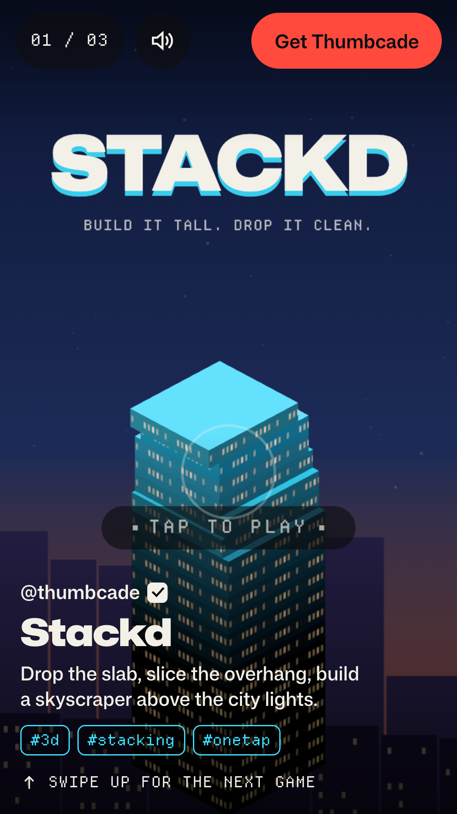

# 05 · The ad is the game (playable)

Thumbcade's product is playable HTML5 games, so its playable ad is the product in miniature: a vertical
mini feed of three real launch games. Nothing is mocked. Every frame on screen is the shipping game,
built from `games/` and running in the same host protocol the app uses.



## Flow

1. **Hook (no touch yet).** Stackd's attract mode is already running full-screen in the Thumbcade feed
   chrome: a `01 / 03` counter, a sound toggle, a heat-red **Get Thumbcade** pill, and the feed caption
   (`@thumbcade`, the game's name, its description, hashtag chips in the game's accent color,
   "↑ Swipe up for the next game"). A slow tap ring (under 1 Hz, no flashing) marks where to touch.
2. **Tap to play.** The caption recedes, the Dock (grabber in the game's accent) slides up, and the run
   starts. Sound unlocks on this first touch and never before.
3. **Result card.** When the run ends, the app's result card appears: score, best (or "New best"),
   **Play again** in the game's accent and **Next game**.
4. **Swipe up, any time.** The feed takes vertical swipes, even mid-run. All three games declare
   `controls.vertical: false`, so a swipe is never ambiguous. The card follows the thumb and snaps on the
   app's spring (damping 26, stiffness 260). Stackd → Flapjack → Kneejerk.
5. **End card**, after a swipe on the third game, or 45 s after the first touch once the current run is
   over (hard stop at 60 s): the logo, "That was three games." (the count is what the player actually
   played), all 12 launch icons with the played ones ringed, "3 of 12 played", "Nine more are one swipe
   away. No installs, no menus, no loading bars.", **Get Thumbcade · Free** and *Play the feed again*.

The store opens only when the player taps a CTA (the top pill, the side CTA in landscape, or the end
card). There are no auto-redirects.

**Why these three games:** they are all tap games, so a swipe up never collides with game input. They
are also three different feelings in 30 seconds: a 3D tower (Stackd, the strongest first frame), a 2D
one-tap flyer (Flapjack), and a reaction test (Kneejerk). Flapjack and Kneejerk are 41 KB and 40 KB of
JS, which leaves the 555 KB of Stackd (Three.js) comfortably inside Meta's 2 MB.

**Credits:** every card says `@thumbcade`. The launch games are made in-house. The seeded creator
personas in the local database are fictional, and an ad must not imply they are real.

## Files

| File | Bytes | For |
|---|---|---|
| `thumbcade-playable-meta.html` | 884,952 | Meta: Facebook, Instagram, Audience Network |
| `thumbcade-playable-mraid.html` | 886,602 | AppLovin, Unity, ironSource, Mintegral, Liftoff (MRAID 2.0) |
| `thumbcade-playable-tiktok.zip` | 324,249 | TikTok Smart+ App Promotion (`index.html` + `config.json`) |
| `thumbcade-playable-google.zip` | 324,170 | Google App campaigns, HTML5 asset (`index.html`) |
| `thumbcade-playable-preview.html` | 885,341 | Local preview: a CTA shows a toast. The overview page embeds this one. |
| `screens/916-*.png` | | 1080×1920 stills for the overview: `hook`, `play`, `result`, `swipe`, `game2`, `game3`, `game3-play`, `end` |
| `screens/portrait-*.png`, `screens/landscape-*.png` | | QA screens at 390×844 and 844×390 (@2x) |

Each file is self-contained. Fonts, icons, the logo and all three games are inlined. The third-party
notices (OFL for Mona Sans and Departure Mono, MIT for Three.js) travel inside each file as an HTML
comment at the end.

## Uploading, per network

Specs were checked against the official pages on 2026-10-17.

### Meta
- A single HTML file **under 2 MB**, with every asset inlined. Ours is 0.84 MB. No HTTP requests, no dynamic
  loading, no JavaScript redirects, and **no `mraid.js`**. The CTA calls `FbPlayableAd.onCTAClick()`. Portrait.
- **A lead-in video is required.** Use
  [`../02-swipe-for-the-next-game/video/thumbcade-12-swipes-6s-9x16.mp4`](../02-swipe-for-the-next-game/video/thumbcade-12-swipes-6s-9x16.mp4)
  (6 s, 9:16, made by the video pipeline). It ends on the same feed the playable opens with.
- Before upload, drop the file into the [Playable Preview tool](https://developers.facebook.com/tools/playable-preview/).
  Every spec item must be green, and the CTA check turns green when `FbPlayableAd.onCTAClick()` fires.
- Sources: [Meta specifications for playable ads](https://en-gb.facebook.com/business/help/412951382532338) ·
  [Playable ads for app ads](https://developers.facebook.com/docs/app-ads/formats/playable-ad/)

### TikTok
- A ZIP **at most 5 MB** with `index.html` and `config.json` at the top level. Ours is 0.31 MB. The config is
  `{"Playable_orientation":1}` (portrait only), with the key spelled as the help page writes it.
- TikTok's playable SDK is included the way the doc instructs, at the bottom of `<body>` before our own
  scripts: `https://sf16-muse-va.ibytedtos.com/obj/union-fe-nc-i18n/Playable/sdk/Playable-sdk.js`. The CTA
  calls `window.openAppStore()`.
- Playables are App Promotion only, in the upgraded Smart+ experience. Store jumps don't work in TikTok's preview.
- Source: [TikTok playable ads](https://ads.tiktok.com/help/article/playable-ads?lang=en)

### Google App campaigns (HTML5)
- A ZIP **at most 5 MB** and at most 512 files. `<meta name="ad.orientation" content="portrait">` and
  `exitapi.js` are in `<head>`. The CTA calls `ExitApi.exit()`. All references are relative (there are none: everything is inline).
- Inline SVG uses explicit end tags (`<path></path>`), as the validator requires. There is no sound before the
  first interaction. HTML5 assets can't run in pre-registration campaigns.
- Sources: [HTML5 assets in App campaigns](https://support.google.com/google-ads/answer/9981650) ·
  [Google Ads help 9948381 (App campaign assets)](https://support.google.com/google-ads/answer/9948381)

### MRAID networks (AppLovin, Unity, ironSource, Mintegral, Liftoff)
- A single HTML file **at most 5 MB**, with `<script src="mraid.js"></script>` (MRAID 2.0; the network injects it).
  The ad waits for `ready` and for the ad to be viewable before it loads the first game. The CTA calls
  `mraid.open(storeUrl)`, picking the iOS or Android link from the user agent.
- AppLovin's rules are all met. The ad timer starts at the first touch. Audio stays muted until that touch and
  pauses whenever the ad is hidden (`viewableChange`, `exposureChange`, `visibilitychange`). Both orientations
  work, and there are no auto-clicks. The WebGL fallback is covered too: a game that never signals ready within
  7 s, or loses its WebGL context, is skipped instead of shown broken.
- Source: [AppLovin creative best practices & guidelines](https://support.applovin.com/en/growth/promoting-your-apps/creatives/best-practices-and-guidelines).
  Unity, ironSource, Mintegral and Liftoff use the same MRAID single-file format, but check each uploader's checklist.

## TODO before upload: store URLs

The MRAID build is the only one that navigates by itself. Its links are in
`marketing/studio/playable/src/config.js`:

```js
window.TC_STORE = {
  ios: "https://apps.apple.com/app/id0000000000",                        // TODO: real App Store id
  android: "https://play.google.com/store/apps/details?id=com.thumbcade.app",
};
```

Set the iOS id once the app exists in App Store Connect, then rebuild. Meta, TikTok and Google send the
click to the store link set on the ad itself, so their builds carry no store URL.

## Rebuild and verify

```bash
pnpm games:build                                   # once: icons in dist/games/ (the end card's 12 icons)
(cd marketing/studio && npm install)               # playwright
(cd marketing/studio/playable && npm install)      # subset-font (Mona Sans subset)
node marketing/studio/playable/build.mjs && node marketing/studio/playable/verify.mjs
node marketing/studio/playable/verify.mjs meta     # one network only (meta | mraid | tiktok | google | preview)
```

`build.mjs` builds each game from source with Vite (about 1 s). `verify.mjs` drives every build in headless
Chromium at 390×844 (touch) and 844×390 and checks the following, then refreshes `screens/`:
- no network request beyond the document (each network's SDK script is served as a stub);
- no page or console errors;
- a tap starts game 1, swipes reach games 2 and 3, and a swipe on game 3 reaches the end card;
- the end-card CTA reaches the network's click-through.

Last run (2026-10-17): **11/11 PASS** across meta, mraid, tiktok, google and preview in portrait and
landscape, plus the 1080×1920 still set. All runs had zero blocked requests and zero errors, and every
game frame was unloaded by the end card.

## How it works

- **The shell is a Thumbcade host.** It answers the SDK's iframe protocol the way the simulator and web
  player do. It sends the `hello` → `LaunchContext`, in-memory `storage`, a local best for
  `leaderboard.*`, `pause`/`resume`, `mute`/`unmute` and `insets`, plus `input.cancel` when it claims a swipe
  and `replay` from the result card. The games run unmodified.
- **Build-time patches** live in memory only, and no repo file changes. The kit's two fonts resolve to
  strings that the shell holds once and injects into each frame. The SDK's standalone fallback never fetches
  `thumbcade.json`, never touches `localStorage`, and hides its dev HUD.
- **Frames.** Each game runs in its own `<iframe srcdoc>` built at runtime from an inert
  `<script type="text/x-tc-game">` block. At most two are alive: the current card, and the next one,
  preloaded 0.7 s after the current one is ready and kept paused. A small probe script inside each frame
  registers its pointer listeners before the SDK's, so the shell can follow a swipe that started inside a
  game.
- Sources: `marketing/studio/playable/src/` contains `shell.html`, `shell.css`, `shell.js`, `probe.js`,
  `adapter-<network>.js` and `config.js`.

## Caveats

- Each network's container was stubbed locally. Nothing has been uploaded yet. Run Meta's Playable Preview,
  TikTok's preview and each MRAID network's test tool before spending.
- TikTok's page asks for "no HTTP requests" but also requires its SDK from a TikTok CDN. We follow the
  doc's script tag exactly. The example `config.json` on that page has a trailing comma, which we drop
  (strict JSON).
- Some validators scan raw text. The minified Three.js inside Stackd contains the SVG and XHTML namespace
  strings and one URL in a comment string. None of them are requests.
- Headless Chromium rendered WebGL through ANGLE/Metal. Real low-end Android WebViews weren't tested. The
  7 s watchdog skips Stackd if WebGL fails there.
