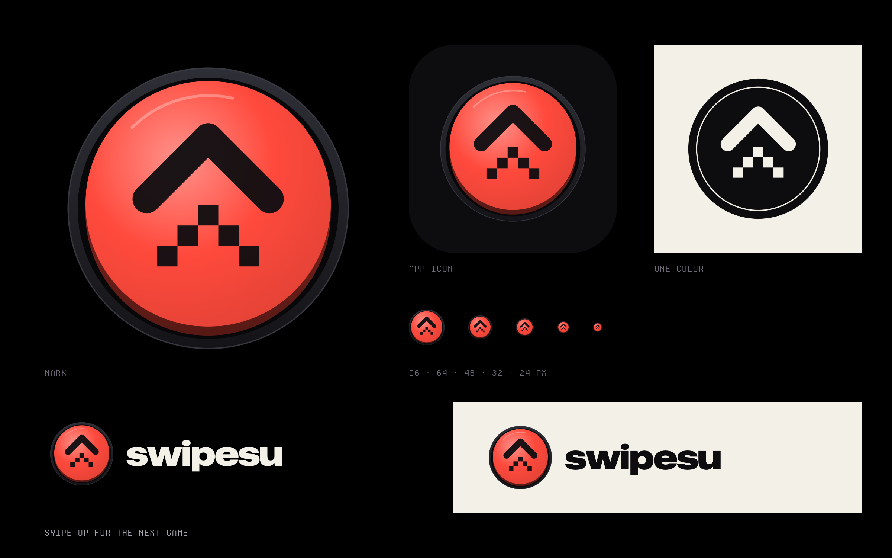

# swipesu

The marketing videos, re-rendered under the name **swipesu** with its own logo. Only this folder uses the name. The
product (apps, portal, `@thumbcade/design-tokens`) is still Thumbcade, and the Thumbcade videos are untouched.



## The logo

The mark is the same top-down red arcade button as Thumbcade's (housing, cap, highlight, `heat`), so every press,
dive and iris in the videos still works. The cap has a new engraving: **a swipe up**. A bold chevron is the gesture.
Under it, a narrower echo of five pixels is the trail the gesture leaves, a real swipe turning into a game. The
echo is narrower so the trail tapers as it falls behind. At favicon size it still reads as "up".

The wordmark is set the same way as Thumbcade's: Mona Sans Display Expanded Black, lowercase, −2 % tracking, in
paper. The idea lives in the mark, and the type stays plain.

| File (`brand/`) | What |
|---|---|
| `mark.svg` | The button alone, transparent |
| `app-icon.svg` / `.png` | 1024 app icon, ink background, full bleed |
| `favicon.svg`, `favicon-32/180/512.png` | Favicons |
| `wordmark.svg`, `wordmark-ink.svg` | The wordmark as paths, paper and ink |
| `lockup.svg` / `.png` | Mark + wordmark |
| `logo-sheet.png` | Everything above on one page, including the one-color version and small sizes |
| `brand.json` | What the video compositors read with `--brand swipesu` |

## Videos (`video/`)

| Folder | Files |
|---|---|
| `teaser/` | `swipesu-teaser-9x16.mp4`, `-16x9.mp4`, `-15s-9x16.mp4`, `-15s-16x9.mp4`, `cover-9x16-logo.png`, `cover-9x16-title.png`, `thumbnail-16x9-logo.png`, `thumbnail-16x9-title.png` |
| `02-swipe-for-the-next-game/` | `swipesu-12-swipes-9x16.mp4`, `-6s-9x16.mp4`, `-4x5.mp4`, covers |
| `03-beat-this/` | `swipesu-beat-531-9x16.mp4`, `-4x5.mp4`, covers |
| `04-zero-installs/` | `swipesu-zero-installs-9x16.mp4`, `-4x5.mp4`, covers |

Same timelines, footage, copy, soundtracks and encoding as the Thumbcade masters. What changes:

- The logo (button engraving and wordmark).
- The name on screen: the `@swipesu` feed handle and its pixel avatar (generated from the handle, like every
  default avatar), `swipesu.com` on the teaser end card and in the challenge link, `npm create swipesu-game` and
  `swipesu publish` in the terminal, and the "■ SWIPESU" label in zero-installs.
- 16:9 teaser end card: the wordmark is shorter at the same type size, so the button moves right to keep the lockup
  centered.
- Teaser opening: the camera dives into the gap between the chevron and its echo, not the cap center, so the dive
  still ends in clean red.

## Regenerate

```bash
node marketing/swipesu/brand.mjs     # logo files + brand.json (uses the design-tokens fonts, palette, sharp, opentype)
bash marketing/swipesu/render.sh     # brand, covers, all eleven videos (about 40 min)
```

`render.sh` needs what the Thumbcade renders need (footage, studio assets, soundtracks; see `../README.md`). Any
single render works too: add `--brand swipesu` to a `trailer/render.mjs` or `studio/video/render.mjs` command.
Without the flag, both renderers produce the Thumbcade versions, pixel for pixel as before.

## Before this goes anywhere

Not checked yet: the swipesu.com domain, the @swipesu handles, and a trademark search on the name.
