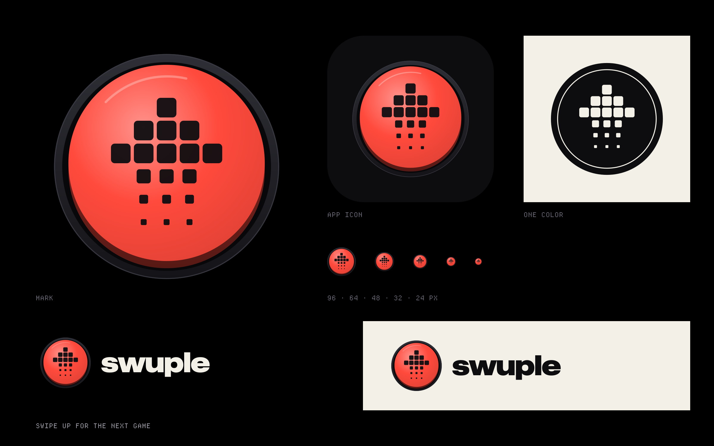

# swuple

The marketing videos, re-rendered under the name **swuple**. Only this folder uses the name. The product (apps,
portal, `@thumbcade/design-tokens`) is still Thumbcade. The Thumbcade videos and the swipesu candidate
(`../swipesu/`) are untouched, so everything can be compared side by side.

swuple has three logos. The first two each have their own full set of videos:

| Folder | Logo |
|---|---|
| this folder | **The button:** Thumbcade's arcade button with a tile arrow engraved on the cap (below) |
| [`swipe/`](swipe/README.md) | **The swipe:** the app icon is a screen, and a swipe up in a gentle S crosses all of it |
| [`script/`](script/README.md) | **The script:** the swipe's S writes the name across the icon, sw / up / le, in one cursive stroke (no videos yet) |

`concepts/` holds the sketch sheets that led there (other marks, mascots, the swipe and script variations). The
scripts next to it draw them: `concepts.mjs`, `marks.mjs`, `mascots.mjs`, `swipe.mjs`, `script.mjs`,
`script-swipe.mjs`, `script-touch.mjs`, `identity.mjs` and `smear.mjs`, with `sketch-kit.mjs` (and, for the swiped
ones, `trail-kit.mjs`) shared between them.

**The thumbprint, swiped** (`concepts/smear-sheet.png`, `smear-homescreen.png`, `smear-icon.png`; `smear.mjs`):
Thumbcade's print again, smooth at the top and turning into half pixels, then full pixels toward the bottom, but a
swipe toward the top right smears it. The ridges on the right of the print bend into the swipe and run out of the
print as streaks, the inner ones furthest, thinning as the ink runs out. The left of the print and its pixel bottom
stay as they were. Variations: streaks off the edge of the icon, three bold ridges, full-weight streaks, streaks
that break off before the tip, and ink on heat, paper on heat, heat on paper. No name in the icon, so it works for
either name.



## The name

**sw**ipe + **up** + **le**, the ending of a game name (Wordle and the like). Swipe up for the next game.

## The logo: the button

The mark is the same top-down red arcade button as Thumbcade's (housing, cap, highlight, `heat`), so every press,
dive and iris in the videos still works. The cap has a new engraving that spells the name:

- **up:** an arrow pointing up,
- **le:** built from rounded game tiles on a five-column grid, the width of a Wordle row,
- **sw:** its shaft dissolves into smaller and smaller tiles (72, 45, 30 %), the trail a swipe leaves behind.

At 24 px the trail drops out and it still reads as an up arrow.

The wordmark is set the same way as Thumbcade's: Mona Sans Display Expanded Black, lowercase, −2 % tracking, in
paper. The idea lives in the mark, and the type stays plain.

| File (`brand/`) | What |
|---|---|
| `mark.svg` | The button alone, transparent |
| `app-icon.svg` / `.png` | 1024 app icon, ink background, full bleed |
| `favicon.svg`, `favicon-32/180/512.png` | Favicons |
| `wordmark.svg`, `wordmark-ink.svg` | The wordmark as paths, paper and ink |
| `lockup.svg` / `.png` | Mark + wordmark |
| `logo-sheet.png` | Everything above on one page, including the one-color version and small sizes |
| `brand.json` | What the video compositors read with `--brand swuple` |

## Videos (`video/`)

| Folder | Files |
|---|---|
| `teaser/` | `swuple-teaser-9x16.mp4`, `-16x9.mp4`, `-15s-9x16.mp4`, `-15s-16x9.mp4`, `cover-9x16-logo.png`, `cover-9x16-title.png`, `thumbnail-16x9-logo.png`, `thumbnail-16x9-title.png` |
| `02-swipe-for-the-next-game/` | `swuple-12-swipes-9x16.mp4`, `-6s-9x16.mp4`, `-4x5.mp4`, covers |
| `03-beat-this/` | `swuple-beat-531-9x16.mp4`, `-4x5.mp4`, covers |
| `04-zero-installs/` | `swuple-zero-installs-9x16.mp4`, `-4x5.mp4`, covers |

**The videos still show the first draft of the logo:** smaller arrow tiles, and "up" raised above the baseline
in the wordmark. Run `render.sh` again to bring them up to date.

Same timelines, footage, copy, soundtracks and encoding as the Thumbcade masters. What changes:

- The logo (button engraving and wordmark).
- The name on screen: the `@swuple` feed handle and its pixel avatar (generated from the handle, like every
  default avatar), `swuple.com` on the teaser end card, `npm create swuple-game` and `swuple publish` in the
  terminal, and the "■ SWUPLE" label in zero-installs.
- 16:9 teaser end card: the wordmark is shorter at the same type size, so the button moves right to keep the lockup
  centered. The tagline under it is now a little wider than the wordmark.
- Teaser opening: the camera dives down the cap's center column into the trail, between its last two tiles, so the
  dive still ends in clean red.

## Regenerate

```bash
node marketing/swuple/brand.mjs      # logo files + brand.json (uses the design-tokens fonts, palette, sharp, opentype)
bash marketing/swuple/render.sh      # brand, covers, all eleven videos (about 40 min)
```

`render.sh` needs what the Thumbcade renders need (footage, studio assets, soundtracks; see `../README.md`). Any
single render works too: add `--brand swuple` to a `trailer/render.mjs` or `studio/video/render.mjs` command.
Without the flag, both renderers produce the Thumbcade versions, pixel for pixel as before.

## Before this goes anywhere

Not checked yet: the swuple.com domain, the @swuple handles, and a trademark search on the name.
