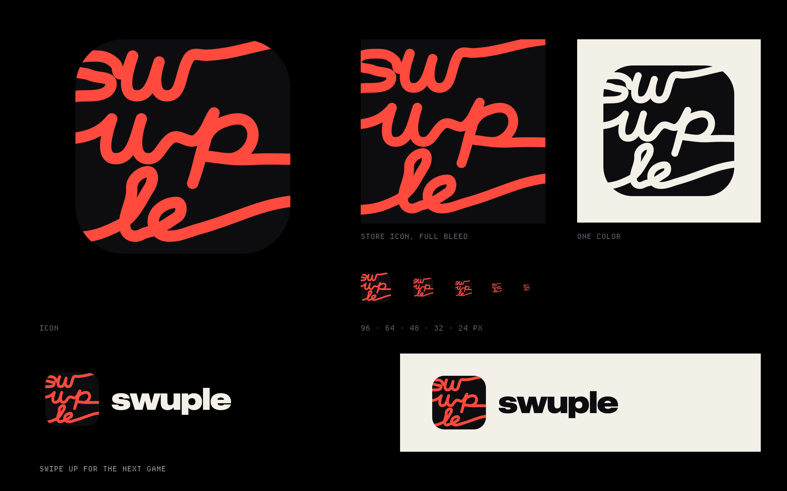

# swuple, script logo

The name written across the app icon by hand. The button version of swuple (`../`), the swipe version
(`../swipe/`) and the Thumbcade masters are untouched, so all of them can be compared side by side.



## The logo

"swuple" in one connected cursive stroke, three rows of two letters: **sw / up / le**. It is the swipe logo's S at
the scale of the word. The rows join at alternating ends, like the strokes of an S:

- **sw → up** on the left, outside the icon. That turn is what cuts the s in half: the writing starts left of the
  icon, so only the right side of the s shows.
- **up → le** on the right, just past the edge. Both tails run into the edge, the e's tail climbing toward the p's,
  so you can see where they meet.

Read as one motion, the stroke comes in at the bottom left, writes "le", turns past the right edge, runs back
through "up", turns past the left edge, writes "sw" and leaves through the top right. It's a swipe up that writes
the word.

The letters are a monoline script with round ends, slanted 12°, like a finger on glass. The stroke is 54 of the
icon's 1024 units: thinner than the swipe so the loops of the l and e stay open. Ink, heat and paper, like the other
logos. The wordmark is the plain swuple wordmark: Mona Sans Display Expanded Black, lowercase, −2 % tracking, in
paper.

| File (`brand/`) | What |
|---|---|
| `icon.svg` | The mark: the icon with its rounded corners, transparent outside them |
| `app-icon.svg` / `.png` | 1024 square, full bleed, for the stores (they apply their own corner mask) |
| `favicon.svg`, `favicon-32/180/512.png` | Favicons |
| `wordmark.svg`, `wordmark-ink.svg` | The wordmark as paths, paper and ink |
| `lockup.svg` / `.png` | Icon + wordmark |
| `logo-sheet.png` | Everything above on one page, including the one-color version and small sizes |

The word reads down to about 64 px. At 32 px and below it is red handwriting rather than letters, so a favicon that
small shows only the gesture.

The sketch sheet with the variations (fade-in, bold, fine, upright, other colorways) is
`../concepts/script-sheet.png`, drawn by `../script.mjs`.

### Next rounds: a swipe on a phone, not paint

Feedback on the sheet above: the word should look swiped on a phone, not painted, and two colors are too plain.

**Round 1, `../concepts/script-swipe-sheet.png`** (`../script-swipe.mjs`): the stroke as a glowing light trail in a
sunset ramp (violet → magenta → heat → tangerine → gold). Rejected: too many colors, and it read as a neon sign,
still writing rather than a swipe.

**Round 2, `../concepts/script-touch-sheet.png`** and `script-touch-homescreen.png` (`../script-touch.mjs`): a
finger. The same word and stroke, but the stroke now ends at a finger coming in from the bottom right, the way you
hold a phone, with its pad on the end of the trail. The trail ages along its length: it starts as a point at the
bottom left, narrow and deep red, and gets wider and lighter toward the finger, where the glass glows a little.
Colors stay ink, heat and paper (the finger is paper), with heat running from deep to light instead of more hues.
Variations: touch rings around the fingertip, an even trail, a wider thumb, no glow, paper on heat, heat on paper,
and the touch point alone without a finger. To end at the finger, the stroke leaves the w down and to the right
(`script({ tail })` in `../script-geometry.mjs`), where the default still leaves through the top right.

**Round 3, its own brand: `../concepts/identity-sheet.png`** and `identity-homescreen.png` (`../identity.mjs`).
swuple stops following Thumbcade's brand: no ink, heat and paper, no Mona Sans, no button. The finger stays, now
white, on an icon in two neighbouring hues (a gradient from the top right to the bottom left) with a white or colored
swipe and one accent color for the light at the fingertip. The swipe fades into the icon toward its start, the oldest
part; colored swipes fade less, since mixed into the icon they turn muddy. Eight color worlds: grape, grape with a
lime swipe, cobalt, bubblegum, mango, teal, midnight with a lime swipe, lemon with a grape swipe. The wordmark is the
same handwriting on one line (`oneLine()` in `../script-geometry.mjs`), with a cursive s that comes up from the
baseline: the icon's s is cut by the edge and never needed a left half. The trail, finger and touch point are drawn
by `../trail-kit.mjs`.

### Why the turn on the right sits outside the icon

Where the turn shows, the p's bowl, its stem and the loop of the turn below it read as a **B** ("uB"). The p's tail
also stays level: if it dips toward the edge, it reads as the leg of an **R**.

## Videos

None yet. The video compositors draw the swipe logo as a filled path, revealed from the bottom up along its
centerline, with the LIVE dot entering at the bottom edge. This logo is a stroke that enters from the left and runs
back through "up", so it needs its own draw-on: write "sw", "up", "le" in reading order, one row after the other.

## Regenerate

```bash
node marketing/swuple/script/brand.mjs   # logo files (geometry: ../script-geometry.mjs)
node marketing/swuple/script.mjs         # the sketch sheet, ../concepts/script-sheet.png
```

## Before this goes anywhere

Not checked yet: the swuple.com domain, the @swuple handles, and a trademark search on the name.
