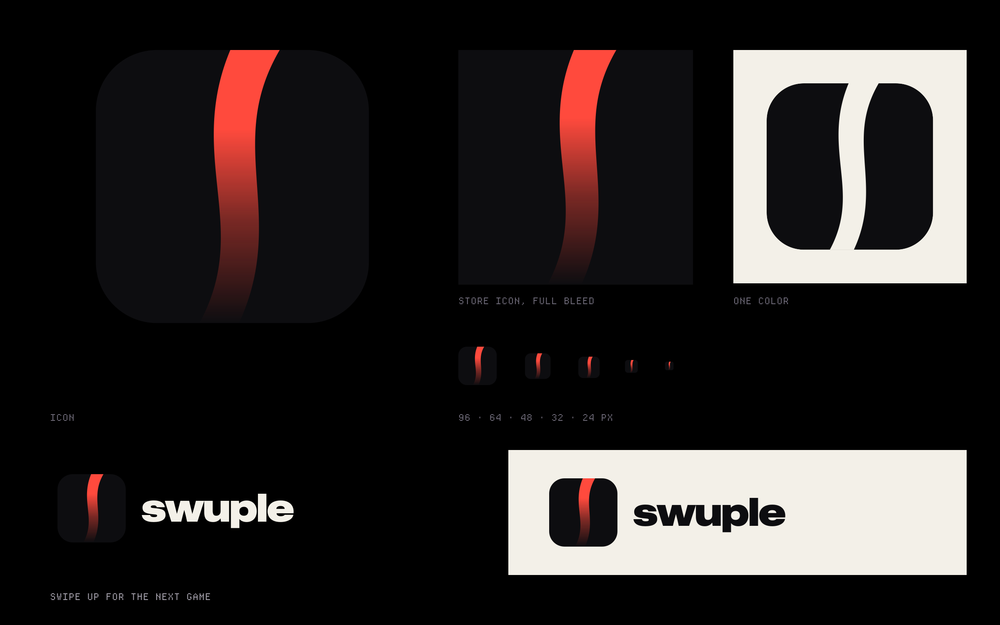

# swuple, swipe logo

The marketing videos, re-rendered under the name **swuple** with the swipe logo. The button version of swuple
(`../`), swipesu (`../../swipesu/`) and the Thumbcade masters are untouched, so all of them can be compared side by side.



## The logo

The app icon is the screen, and a swipe up crosses all of it. The swipe comes in below the bottom edge and leaves
through the top, bends in a gentle S (the name's first letter, as a hint, not a letter), and fades in from nothing to
solid heat on the way up, so the motion reads in a still. Ink, heat and paper, like the button logo. It was "B, edge
to edge" on the sketch sheet (`../concepts/swipe-sheet.png`).

The wordmark is the plain swuple wordmark: Mona Sans Display Expanded Black, lowercase, −2 % tracking, in paper.

| File (`brand/`) | What |
|---|---|
| `icon.svg` | The mark: the icon with its rounded corners, transparent outside them |
| `app-icon.svg` / `.png` | 1024 square, full bleed, for the stores (they apply their own corner mask) |
| `favicon.svg`, `favicon-32/180/512.png` | Favicons |
| `wordmark.svg`, `wordmark-ink.svg` | The wordmark as paths, paper and ink |
| `lockup.svg` / `.png` | Icon + wordmark |
| `logo-sheet.png` | Everything above on one page, including the one-color version and small sizes |
| `brand.json` | What the video compositors read with `--brand swuple/swipe` |

The fade is a gradient, so it needs a screen or full-color print. The one-color version cuts the swipe out of a solid
icon instead; at that size and in one color it can read as a coffee bean, so keep it for places that really are
one color.

## Videos (`video/`)

| Folder | Files |
|---|---|
| `teaser/` | `swuple-swipe-teaser-9x16.mp4`, `-16x9.mp4`, `-15s-9x16.mp4`, `-15s-16x9.mp4`, `cover-9x16-logo.png`, `cover-9x16-title.png`, `thumbnail-16x9-logo.png`, `thumbnail-16x9-title.png` |
| `02-swipe-for-the-next-game/` | `swuple-swipe-12-swipes-9x16.mp4`, `-6s-9x16.mp4`, `-4x5.mp4`, covers |
| `03-beat-this/` | `swuple-swipe-beat-531-9x16.mp4`, `-4x5.mp4`, covers |
| `04-zero-installs/` | `swuple-swipe-zero-installs-9x16.mp4`, `-4x5.mp4`, covers |

Same timelines, footage, copy, soundtracks and encoding as the Thumbcade masters, and the same name on screen as the
button version of swuple. Where the button was, the icon is, at the footprint of the button's housing:

- **Teaser opening.** The icon pops in over "Swipe to start" (instead of "Press start"). On the beat where the button
  was pressed, the swipe flicks up across it, and the camera dives into the swipe where it is solid red.
- **Teaser end card.** The LIVE dot from the terminal travels to the icon's bottom edge, where the swipe comes in,
  and becomes the fingertip: the icon pops in around it, and on the beat the dot swipes up and draws the swipe.
- **15 s cut.** The iris closes on the icon's rounded square instead of a circle, and lands as the empty icon.
- **Ad end cards.** The icon pops, and the swipe flicks across it on the beat where the button was pressed.
- The shockwaves are squared off like the icon. A hairline edge keeps the ink icon visible on the black stage.

The soundtracks are the shared ones, so the end card's press sound plays under the swipe.

## Regenerate

```bash
node marketing/swuple/swipe/brand.mjs     # logo files + brand.json (geometry: ../swipe-geometry.mjs)
bash marketing/swuple/swipe/render.sh     # brand, covers, all eleven videos (about 40 min)
```

`render.sh` needs what the Thumbcade renders need (footage, studio assets, soundtracks; see `../../README.md`). Any
single render works too: add `--brand swuple/swipe` to a `trailer/render.mjs` or `studio/video/render.mjs` command.
The icon support in the compositors (`trailer/comp/trailer.js`, `studio/video/comp/kit.js`) only switches on when a
brand has an `icon`; every other brand renders exactly as before.

## Before this goes anywhere

Not checked yet: the swuple.com domain, the @swuple handles, and a trademark search on the name.
